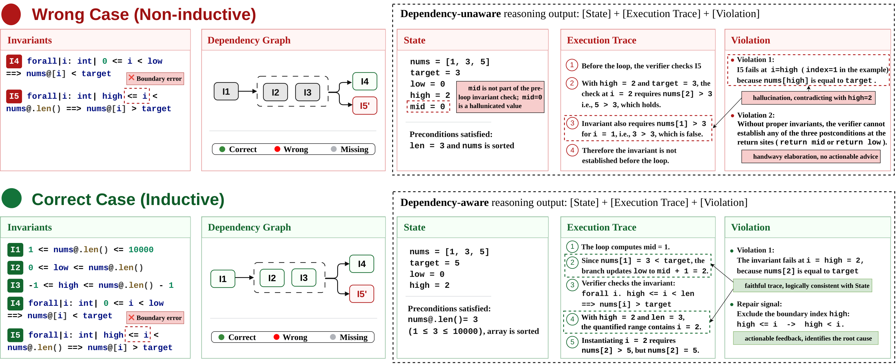

<h1 align="center">TopoVerus: Curriculum Proof Repair<br>with Learned Counterexamples</h1>

<p align="center">
  Yuechun Sun &nbsp;·&nbsp; Jun Yang &nbsp;·&nbsp; Kexin Pei<br>
  University of Chicago
</p>

<p align="center">
  <a href="https://huggingface.co/YuechunSun/TopoVerus-32B"></a>
  <a href="results/README.md"></a>
  <a href="docs/case-studies/README.md"></a>
  <a href="LICENSE"></a>
</p>

## About

**TopoVerus** learns to diagnose failed Verus proofs and repair their annotations.
Given a failed proof and verifier feedback, the model generates a structured
counterexample with **[State]**, **[Execution Trace]**, and **[Violation]** fields,
a repair plan, and the repaired program.

Starting from QwQ-32B, counterexample-guided supervised fine-tuning teaches this
output format, and GRPO optimizes repair using verifier feedback and safety
checks. The **Topological Graph Reward** uses dependencies among loop invariants
to reward coverage and prerequisite ordering during proof construction.

This repository contains the training and evaluation code, configurations,
reported paper results, and case-study sources. The full-weight BF16 model is
available on [Hugging Face](https://huggingface.co/YuechunSun/TopoVerus-32B).

[](assets/topoverus-dependency-diagnostics.pdf)

*Binary-search example from the paper: dependency-unaware diagnostics (top) and
dependency-aware diagnostics (bottom). [View the PDF](assets/topoverus-dependency-diagnostics.pdf).*

## Repository Contents

| Path | Contents |
| --- | --- |
| `topoverus/` | Proof-repair evaluation, data preparation, invariant matching, rewards, and training launchers |
| `configs/` | SFT and GRPO configurations, reward settings, dependency versions, and data manifests |
| `scripts/` | Model download, data preparation, training, checkpoint export, and result summarization |
| `third_party/` | Pinned VERL and Lynette sources, patches, and licenses |
| `assets/` | Paper diagnostic figure in PDF and WebP formats |
| `results/` | Results reported in the paper, in Markdown and CSV |
| `docs/` | Model usage, training, data formats, evaluation modes, and licensing |
| `docs/case-studies/` | Appendix B programs, verifier messages, generated counterexamples, and source identifiers |
| `tests/` | Unit tests and Verus/Lynette integration checks |

## Setup

For batch evaluation, use Python 3.12 and a compatible CUDA environment. Run
commands from this repository's root:

```bash
python -m pip install -r configs/rl-requirements.txt
python -m pip install flash-attn==2.7.4.post1 --no-build-isolation
python -m pip install --no-deps -e .
```

Provide a Verus binary when evaluating. Verus `0.2025.07.12.0b6f3cb` was used
for local validation. Rust/Cargo is needed to build the optional Lynette checker.

## Use the Model

[TopoVerus-32B](https://huggingface.co/YuechunSun/TopoVerus-32B) contains full BF16
weights derived from QwQ-32B. The weights occupy approximately 61 GiB; generation
requires additional memory. See the [Transformers quick start](docs/model-cards/dep-v2.md)
for loading the model and generating a repair for a single program.

Download the weights for batch evaluation:

```python
from huggingface_hub import snapshot_download

snapshot_download(
    repo_id="YuechunSun/TopoVerus-32B",
    local_dir="data/models/TopoVerus-32B",
)
```

## Evaluation

Prepare `data/eval.jsonl` using the [task format](docs/DATA.md), then run:

```bash
PYTHONNOUSERSITE=1 python -m topoverus.evaluate \
  --model data/models/TopoVerus-32B \
  --tasks data/eval.jsonl \
  --run runs/evaluation \
  --samples 3 --iterations 10 --ks 1 3 \
  --max-prompt-tokens 24576 --max-response-tokens 8192 \
  --verus /absolute/path/to/verus
```

Evaluation defaults to **Verus only**. It runs three independent chains with up
to ten attempts per chain, including the initial generation. A chain stops when
Verus accepts a candidate. The input and output budgets total 32768 tokens.

To enable source-preservation checks, build Lynette:

```bash
python scripts/prepare_safety_tool.py
```

Add `--lynette .deps/lynette-safety-v4/target/release/lynette` to the evaluation
command. A chain then stops when both verification and safety checks pass.
See [evaluation modes](docs/SAFETY.md) for metric definitions.

### Outputs

The selected `runs/` directory stores model responses, generated programs,
verifier feedback, token counts, and metrics. Each run requires a new output
directory. Use `scripts/summarize_results.py` to export summaries from compatible
completed runs.

## Training

The training route is:

```text
QwQ-32B → Counterexample SFT → Dependency-aware GRPO
```

Use separate SFT and RL environments. The [training guide](docs/TRAINING.md)
covers environment setup, base-model download, data preparation, and launch
commands. The entry points are `scripts/train_sft.sh` and `scripts/train_dep.sh`;
their configurations are in `configs/`. Training requires the safety checker.

## Results Reported in the Paper

The paper reports weighted-average **Safe-Pass@1 of 61.6%** and
**Safe-Pass@3 of 72.2%** across seven benchmarks. See the [complete paper table](results/README.md)
and [CSV](results/paper-results.csv) for per-benchmark results. These numbers
describe the paper's experiments.

## Case Studies

The three examples in Appendix B provide the program, verifier feedback,
generated counterexample, and source identifiers:

| Case | Task | Diagnosis |
| --- | --- | --- |
| A | DafnyBench `program_422_count_less_than` | Assertion placed between `pop` and `push` |
| B | LeetCode 121 `BestTimeSell` | Full-array claim used as a prefix invariant |
| C | VerusBench `task_id_447` | Arithmetic bounds missing from the loop context |

See the [case-study sources](docs/case-studies/README.md) for the original artifacts.

## Tests

```bash
python -m unittest discover -s tests
```

Set `VERUS_BIN` and `LYNETTE_BIN` to include the real-tool regressions. Build the
checker with `scripts/prepare_safety_tool.py`.

## Citation

```bibtex
@misc{sun2026topoverus,
  title  = {Curriculum Proof Repair with Learned Counterexamples},
  author = {Yuechun Sun and Jun Yang and Kexin Pei},
  year   = {2026}
}
```

## License

Original TopoVerus code is MIT licensed. Model weights use Apache-2.0.
Third-party code and benchmark excerpts retain their source terms; see
[licensing](docs/LICENSING.md).
